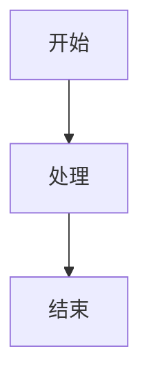

# Firefly 博客使用指南

> 博客项目路径：`D:\projects\blog`
> 包管理器：**pnpm**（强制，不支持 npm）
> 访问地址：`http://localhost:4321/spinach-blog/`
> Obsidian 博客草稿路径：`D:\projects\doc\05-knowledge\博客草稿`

## 一、日常操作

### 启动/停止

```bash
cd D:\projects\blog

# 启动开发服务器
pnpm dev

# 构建生产版本
pnpm build

# 预览构建结果
pnpm preview
```

### Obsidian 写作同步工作流

**推荐方式**：在 Obsidian 里写完笔记 → 跑一条命令同步到博客。

**步骤**：

1. **在 Obsidian 中写文章**

   在 vault 的 `博客草稿` 文件夹（`D:\projects\doc\05-knowledge\博客草稿`）中新建 `.md` 文件，正常写笔记即可。

   Obsidian 笔记的 frontmatter 和博客不完全兼容，脚本会自动处理：

   | Obsidian 字段 | Firefly 字段 | 说明 |
   |--------------|-------------|------|
   | `date` | `published` | 发布日期 |
   | `tags: [a, b]` | `tags:\n  - a\n  - b` | 标签列表 |
   | `[[wikilink]]` | `[wikilink](./slug)` | 自动转标准链接 |
   | `![[image.png]]` | `` | 嵌入图片 |

2. **放置图片**

   如果有图片，放在 `博客草稿/attachments/` 目录下，在 Obsidian 中用 `![[image.png]]` 引用即可。

3. **一键同步**

   ```bash
   cd D:\projects\blog
   pnpm sync:obsidian
   ```

   同步脚本会：
   - 自动提取 `# 标题` 作为文章标题（如果没写 frontmatter）
   - 自动生成 `published` 日期（当天）
   - 自动提取第一段作为 `description`
   - 转换 Obsidian 专有语法（wikilinks、嵌入图片）
   - 复制附件图片到文章目录
   - 输出到 `src/content/posts/`

4. **本地预览**

   ```bash
   pnpm dev
   # 打开 http://localhost:4321/spinach-blog/
   ```

### 创建新文章（直接模式）

如果不经过 Obsidian，也可以直接在博客目录创建：

```bash
# 方式一：直接新建文件
src/content/posts/my-first-post.md

# 方式二：带图片的文章（推荐）
mkdir src/content/posts/my-first-post/
# 然后创建：
src/content/posts/my-first-post/index.md
src/content/posts/my-first-post/thumbnail.jpg    # 封面图
src/content/posts/my-first-post/image1.jpg       # 文章内图片
```

文章 frontmatter 必填字段：

```yaml
---
title: '文章标题'
published: '2026-04-24'        # 发布日期（必须，格式 YYYY-MM-DD）
updated: '2026-04-25'          # 更新日期（可选）
description: '文章简短描述'      # 用于列表页和 SEO
tags:                           # 标签列表
  - Java
  - Spring Boot
category: '后端开发'             # 分类（可选）
image: './thumbnail.jpg'        # 封面图路径（可选）
pinned: false                   # 是否置顶（可选）
draft: false                    # 草稿标记，true 时不发布
---
```

## 二、分类与标签

### 文章分类

在 frontmatter 中设置 `category` 字段：

```yaml
category: '后端开发'
```

分类导航栏会自动显示。在 `src/config/siteConfig.ts` 中控制开关：

```typescript
categoryBar: true,  // 设为 false 隐藏分类导航
```

### 标签管理

在 frontmatter 中设置 `tags` 字段：

```yaml
tags:
  - Java
  - Kafka
  - AI
```

标签不需要预先创建，写完后自动在侧边栏和标签页显示。

## 三、站点配置

核心配置文件在 `src/config/` 目录：

| 文件 | 用途 | 常用修改项 |
|------|------|-----------|
| `siteConfig.ts` | 站点总配置 | 标题、描述、主题色、分页大小、页面开关 |
| `profileConfig.ts` | 个人信息 | 头像、名字、签名、社交链接 |
| `navBarConfig.ts` | 导航菜单 | 顶部导航项、下拉菜单 |
| `sidebarConfig.ts` | 侧边栏 | 左侧/右侧边栏内容 |
| `footerConfig.ts` | 页脚 | 版权信息、社交链接 |
| `commentConfig.ts` | 评论 | 启用/禁用评论、Waline/Giscus 配置 |
| `friendsConfig.ts` | 友链 | 友链申请信息 |
| `sponsorConfig.ts` | 赞助 | 赞助方式、收款码 |

### 修改个人信息（示例）

`src/config/profileConfig.ts`：

```typescript
export const profileConfig: ProfileConfig = {
    avatar: "assets/images/avatar.avif",  // 头像路径（src 目录下）
    name: "菠菜",
    bio: "Java 工程师 / AI 探索者",
    links: [
        {
            name: "GitHub",
            icon: "fa7-brands:github",
            url: "https://github.com/amazing36",
            showName: false,
        },
        {
            name: "Email",
            icon: "fa7-solid:envelope",
            url: "mailto:your@email.com",
            showName: false,
        },
    ],
};
```

图标从 [Icônes](https://icones.js.org/) 获取，搜索后复制图标代码（如 `fa7-brands:github`）。

### 修改导航菜单

`src/config/navBarConfig.ts`：

```typescript
export const navBarConfig: NavBarConfig = {
    links: [
        {
            icon: "material-symbols:home-outline",
            title: "首页",
            link: "/",
        },
        {
            icon: "material-symbols:archive-outline",
            title: "归档",
            link: "/archive",
        },
        {
            icon: "material-symbols:group-outline",
            title: "友链",
            link: "/friends",
        },
    ],
};
```

## 四、图片管理

### 文章封面图

1. **推荐方式**：文章放在文件夹中，图片放在同级目录
   ```
   src/content/posts/my-post/
   ├── index.md
   └── thumbnail.jpg
   ```
   frontmatter 中引用：`image: './thumbnail.jpg'`

2. **放在 images 目录**：
   ```
   src/content/posts/images/photo.jpg
   ```
   文章中引用：``

### 更换头像

1. 把新头像图片放到 `src/assets/images/` 目录
2. 修改 `profileConfig.ts` 中的 `avatar` 路径

## 五、Markdown 扩展功能

### Callout（提示框）

```markdown
:::tip 提示标题
这是提示信息
:::

:::note 注意
这是注意事项
:::

:::warning 警告
这是警告内容
:::
```

### KaTeX 数学公式

行内公式：`$E = mc^2$`

块级公式：
```markdown
$$
\int_0^\infty e^{-x^2} dx = \frac{\sqrt{\pi}}{2}
$$
```

### Mermaid 图表

````markdown

````

### 代码块

````markdown
```java
@SpringBootApplication
public class Application {
    public static void main(String[] args) {
        SpringApplication.run(Application.class, args);
    }
}
```

```java {1-3} showLineNumbers
// 带行号和区域高亮
public class Hello {}
```
````

## 六、部署到 GitHub Pages

### 自动部署

推送到 `main` 分支会自动触发 GitHub Actions：

```bash
cd D:\projects\blog
git add .
git commit -m "更新博客内容"
git push origin main
```

### 配置文件说明

- `astro.config.mjs` 中的 `base: "/spinach-blog"` 用于 GitHub Pages 子路径
- `.github/workflows/deploy.yml` 使用 pnpm 构建
- `site: "https://amazing36.github.io"` 是站点域名

### 本地开发 vs 生产部署

| 配置 | 本地开发 | 生产部署 |
|------|---------|---------|
| `base` 路径 | `/spinach-blog` | `/spinach-blog` |
| 访问地址 | `localhost:4321/spinach-blog/` | `amazing36.github.io/spinach-blog/` |
| 图片路径 | 相对路径 | 自动加 base 前缀 |

## 七、常用路径速查

| 路径 | 说明 |
|------|------|
| `src/content/posts/` | 文章目录 |
| `src/content/spec/` | 独立页面内容（如 about） |
| `src/config/` | 所有配置文件 |
| `public/` | 静态资源（favicon 等） |
| `src/assets/images/` | 需要 Astro 处理的图片 |
| `.github/workflows/` | CI/CD 配置 |

## 八、故障排查

### 构建失败：`published: Expected type "date"`

**原因**：frontmatter 中的日期格式不对。

**解决**：确保 `published` 字段格式为 `YYYY-MM-DD`，如 `published: '2026-04-24'`。

### 构建失败：`ImageNotFound`

**原因**：图片路径不存在。

**解决**：检查图片文件是否存在于文章同级目录。

### 端口被占用

**现象**：Dev server 自动切换到其他端口。

**解决**：
```bash
# 查找占用端口的进程
lsof -ti:4321 | xargs kill -9

# 或者指定端口启动
pnpm dev -- --port 4321
```

### 修改配置后不生效

**原因**：部分配置修改需要重启开发服务器。

**解决**：`Ctrl+C` 停止后重新 `pnpm dev`。
